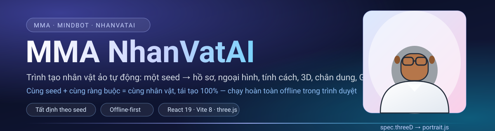

# MMA NhanVatAI — trình tạo nhân vật ảo tự động

<p>


= 20.19" src="https://img.shields.io/badge/Node-%E2%89%A5%2020.19-339933?logo=nodedotjs&logoColor=white">


</p>

**Một seed → một nhân vật ảo hoàn chỉnh.** Hồ sơ, ngoại hình, trang phục, tính cách, giọng
nói, chỉ số RPG, prompt ảnh AI và tham số 3D — tất cả được **sinh tất định** từ một chuỗi seed
duy nhất. Cùng seed + cùng ràng buộc ⇒ **cùng nhân vật**, tái tạo được 100% trên bất kỳ máy
nào, **không cần lưu ảnh, không cần server**.

> **Toàn bộ phần lõi chạy offline trong trình duyệt:** sinh nhân vật, dựng model 3D bằng
> three.js, vẽ chân dung SVG, thư viện nhân vật, nhập/xuất JSON, xuất GLB.
> Backend FastAPI ở [`api/`](api/) (Blender dựng GLB có rig, chân dung PNG/AI, thư viện trên
> server) là **lớp nâng cấp tuỳ chọn** — không bật API thì web vẫn dùng được đầy đủ.

| Ba con số | Ý nghĩa |
| --- | --- |
| **3** | phụ thuộc runtime duy nhất khi chạy: `react`, `react-dom`, `three` — không framework CSS, không state library |
| **3.625** | dòng mã nguồn + kiểm thử (21 file JS/JSX/MJS), cộng thêm 543 dòng CSS viết tay |
| **112** | kiểm thử tự động đang **PASS** (29 engine + 62 hình học 3D + 21 giao diện) |

## Mục lục

- [Điểm khác biệt](#điểm-khác-biệt)
- [Ảnh xem trước](#ảnh-xem-trước)
- [Tính năng](#tính-năng)
- [Bắt đầu nhanh](#bắt-đầu-nhanh)
- [Kiến trúc](#kiến-trúc)
- [Bộ dữ liệu](#bộ-dữ-liệu)
- [Hợp đồng dữ liệu spec](#hợp-đồng-dữ-liệu-spec)
- [Kiểm thử](#kiểm-thử)
- [Backend API tuỳ chọn](#backend-api-tuỳ-chọn)
- [Triển khai lên Vercel](#triển-khai-lên-vercel)
- [Cấu trúc thư mục](#cấu-trúc-thư-mục)
- [Quy ước code](#quy-ước-code)
- [Lộ trình](#lộ-trình)
- [FAQ](#faq)
- [Giấy phép](#giấy-phép)

## Điểm khác biệt

**1. Tất định, không phải "random cho vui".** Character Engine dùng hash `xmur3` + PRNG
`mulberry32` (`web/src/engine/rng.js`) nên đầu ra chỉ phụ thuộc seed và các ràng buộc — không
phụ thuộc `Math.random`, không phụ thuộc thứ tự gọi. `id` nhân vật là
`nv-<slug-tên>-<8 ký tự hash>`, nên **hai máy khác nhau nhập cùng seed sẽ ra cùng một id**. Đây
là điều kiện để sinh nhân vật theo lô, kiểm thử hồi quy, và tái tạo lại nhân vật cũ chỉ từ
seed.

**2. Offline-first thật sự.** Không có bước build nào cần mạng, không có API key nào bắt buộc.
Mở `npm run dev` là dùng được ngay: sinh nhân vật, xoay model 3D, tải SVG/PNG/GLB/JSON. AI chỉ
được gọi khi người dùng bấm nút tương ứng.

**3. Một nguồn sự thật duy nhất cho ngoại hình: `spec.threeD`.** three.js (`viewer/figure.js`),
bộ vẽ chân dung SVG (`portrait.js`) và Blender (qua API) **cùng đọc một hợp đồng tham số** —
`heightM`, `mass`, `width`, `faceRatio`, `jawWidth`, `skin`, `hairMesh`, `accessoryMesh`… Nhờ
vậy model 3D, ảnh 2D và file GLB **luôn khớp nhau**, không có chuyện "ảnh một đằng model một nẻo".

**4. Dữ liệu hoá, không hard-code.** Mọi danh mục nằm trong `tables.js` / `tables2.js`; giao
diện lấy danh mục từ `FIELD_OPTIONS` của engine. Muốn thêm nghề, kiểu tóc hay phụ kiện mới:
sửa bảng dữ liệu + ánh xạ mesh trong `figure.js`, **không phải chạm vào UI**.

## Ảnh xem trước

|  | **Chân dung 2D do chính dự án vẽ ra** — file [`tools/preview.svg`](tools/preview.svg) (50 dòng SVG) được `web/src/portrait.js` sinh từ `spec.threeD`: đúng màu da, màu tóc, kiểu tóc, kiểu râu, màu mắt, phụ kiện (kính), trang phục và cả bảng tên nhân vật.<br><br>Không gọi AI, không tốn lượt, chạy trong ~1 ms, và vì dùng chung hợp đồng tham số với three.js nên **luôn khớp model 3D đang xem**. Nút *PNG* trong giao diện chỉ đổi SVG này sang raster ở kích thước bạn chọn. |
| :--: | :-- |


## Tính năng

| Nhóm | Bạn nhận được gì |
| --- | --- |
| **Sinh nhân vật tất định** | Từ 1 seed sinh ra hồ sơ đầy đủ: tên, tuổi, giới tính, quê quán, nghề nghiệp, chiều cao, vóc dáng, dáng mặt, màu da, kiểu & màu tóc, kiểu râu, màu mắt, trang phục + bảng màu, phụ kiện, nguyên mẫu tính cách, 3–5 nét tính cách, sở thích/điều không thích, câu phương châm, chỉ số RPG 0–20, giọng nói, prompt tiếng Anh và tham số 3D |
| **Ràng buộc & sửa tay** | Khoá sẵn giới tính / nghề nghiệp trước khi sinh (`pinned`); sửa bất kỳ ô ngoại hình nào thì **toàn bộ trường dẫn xuất tự tính lại** — nhãn tiếng Việt, mô tả nhiều đoạn, prompt AI, tham số 3D và `id`. Đổi nghề ⇒ trang phục, đồ nghề và nhãn nghề đổi theo |
| **Xem 3D tức thời** | three.js dựng nhân vật trong trình duyệt (mesh thuần, không cần asset ngoài): pose động kiểu "thở", chế độ wireframe, khoá xoay tự động, camera mặc định, chụp ảnh PNG, đổi nhân vật không rò rỉ bộ nhớ (`dispose()` tường minh cho geometry/material) |
| **Chân dung 2D miễn phí** | `portrait.js` vẽ chân dung SVG **từ chính `spec.threeD`**: mắt có tròng + điểm sáng, lông mày, má hồng, kiểu tóc theo id, kính/khuyên tai/headset vẽ bằng hình học, nền gradient + bảng tên. Tải SVG (vector) hoặc PNG ở kích thước tuỳ chọn |
| **AI nâng cấp (tuỳ chọn)** | Prompt tiếng Anh ghép theo đúng tham số nhân vật (`promptEn.js`), **chỉ gọi khi bấm nút**, đi theo chuỗi dự phòng Gemini → MeToken → Pollinations |
| **Thư viện nhân vật** | Lưu trong `localStorage` (`nhanvatai.library.v1`, tối đa 200 bản ghi): thumbnail **không lưu ảnh** mà dựng lại bằng `portrait.js`, nên thư viện 200 nhân vật vẫn nhẹ. Nhập/xuất cả bộ JSON, tự ghi đè theo `id` |
| **Xuất file** | Character card JSON (để nhập lại), SVG, PNG, và **GLB xuất trực tiếp từ three.js** (nhanh, không cần server); GLB dựng bằng Blender có rig khi bật API |
| **Giao diện 3 cột** | Trái: điều khiển (seed, ràng buộc, ngoại hình, nhập/xuất) · Giữa: sân khấu 3D + chân dung · Phải: hồ sơ 4 tab (Hồ sơ · Mô tả · Prompt AI · JSON) + thư viện. Token thiết kế bằng biến CSS, có toast thông báo và đèn báo trạng thái API |
| **Không phụ thuộc** | Không framework CSS, không state library, không dịch vụ ngoài. Chỉ `react`, `react-dom`, `three` |

## Bắt đầu nhanh

**Yêu cầu:** Node.js `^20.19.0` hoặc `>=22.12.0` (theo yêu cầu của Vite 8) và npm. Không cần
Blender, không cần API key — mọi thứ ở dưới đều chạy offline.

```bash
# 1. Lấy mã nguồn
git clone https://github.com/MindMachineAi/mma_nhanvatai.git
cd mma_nhanvatai/web

# 2. Cài phụ thuộc (chỉ 3 gói runtime)
npm install

# 3. Chạy chế độ phát triển
npm run dev          # http://localhost:5173
```

Mở `http://localhost:5173`, bấm **Tạo nhân vật mới** (hoặc **Ngẫu nhiên** để lấy seed mới) là
đã có một nhân vật đầy đủ để xem 3D, tải chân dung và xuất file.

| Lệnh (trong `web/`) | Việc nó làm |
| --- | --- |
| `npm run dev` | Vite dev server + hot reload tại cổng `5173` |
| `npm run build` | Build production vào `web/dist/` (không cần biến môi trường) |
| `npm run preview` | Xem thử bản build tại cổng `5173` |
| `node tools/selftest.mjs` *(chạy ở gốc repo)* | 29 kiểm thử Character Engine |
| `node tools/selftest3d.mjs` *(chạy ở gốc repo)* | 62 kiểm thử hình học/3D |
| `npx vite build --ssr tools/smoke-ui.jsx --outDir tools/_out --logLevel warn && node tools/_out/smoke-ui.js` *(trong `web/`)* | 21 kiểm thử giao diện |

### Cấu hình tuỳ chọn

Chỉ cần khi bạn bật backend FastAPI. Sao chép `.env.example` thành `.env`:

```ini
API_HOST=127.0.0.1
API_PORT=8077
CORS_ORIGINS=http://localhost:5173
BLENDER_PATH=blender
BLENDER_TIMEOUT=240
GEMINI_API_KEY=            # tuỳ chọn
METOKEN_API_KEY=           # tuỳ chọn
PORTRAIT_ALLOW_POLLINATIONS=true
LIBRARY_DIR=./data/library
VITE_API_BASE=http://127.0.0.1:8077   # chỉ dùng cho web dev
```

Bỏ trống `VITE_API_BASE` ⇒ web tự chạy ở chế độ offline và hiển thị “API đang tắt”; các nút cần
server sẽ báo lỗi tiếng Việt dễ hiểu thay vì treo giao diện.


## Kiến trúc

Luồng dữ liệu là **một chiều**: seed đi vào engine, engine trả ra `spec`, mọi thứ khác (UI, 3D,
SVG, GLB, AI) chỉ **đọc** `spec` và không tự sinh dữ liệu.

```text
   seed (chuỗi) + ràng buộc (giới tính, nghề)
                    │
                    ▼
        ┌───────────────────────────┐
        │  CHARACTER ENGINE         │   rng.js        xmur3 + mulberry32  (tất định)
        │  (thuần JS, không React)  │   tables*.js    26 nghề, 12 tóc, 12 trang phục, …
        └─────────────┬─────────────┘   promptEn.js   prompt ảnh tiếng Anh
                      │                 color.js      tiện ích màu
                      ▼
        ┌───────────────────────────┐
        │  spec  (1 nguồn sự thật)  │   identity · appearance · outfit · personality
        └─────────────┬─────────────┘   voice · rpg · labels · description · prompt · threeD
                      │
   ┌──────────────────┼───────────────────┬──────────────────┬─────────────────┐
   ▼                  ▼                   ▼                  ▼                 ▼
spec.threeD       labels[]           description         prompt           voice   (bước 7)
   │                  │                   │                  │                 │
   ├──▶ figure.js ──▶ Viewer3D.jsx   InfoPanel 4 tab ◀─── promptEn ──▶ AI vẽ ảnh  │
   │      (three.js)      │                                                       │
   │                      └──▶ GLB (GLTFExporter, ngay trong trình duyệt)         │
   └──▶ portrait.js ──▶ SVG / PNG                                                  │
                                                                                   │
   ── Lớp nâng cấp qua API: api/ (tuỳ chọn, có trong repo) ──────────────────────────
   api/ FastAPI ─┬─▶ Blender headless ──▶ GLB có rig (19 xương)
                 │     (hoặc addon cầu nối trong Blender đang mở)
                 ├─▶ Pillow ──▶ chân dung PNG, không cần mạng
                 ├─▶ Gemini → MeToken → Pollinations ──▶ chân dung AI
                 ├─▶ DeepSeek ──▶ viết lại prompt + nâng cấp hồ sơ
                 └─▶ thư viện nhân vật trên server
```

| Tầng | Vị trí | Trách nhiệm |
| --- | --- | --- |
| **Hạt nhân** | `web/src/engine/` | Sinh nhân vật tất định, bảng dữ liệu, prompt, tiện ích màu. **Không import React, không đụng DOM** ⇒ chạy được bằng Node để kiểm thử |
| **Dựng hình** | `web/src/viewer/` | `figure.js` biến `spec.threeD` thành mesh three.js thuần; `Viewer3D.jsx` lo scene/camera/ánh sáng, vòng lặp render, export GLB, `dispose()` khi đổi nhân vật |
| **Chân dung** | `web/src/portrait.js` | Sinh SVG thuần từ `spec.threeD` (không canvas, không AI), đổi SVG → PNG khi người dùng cần |
| **Giao diện** | `web/src/ui/`, `App.jsx` | 5 panel nhận prop + callback; **không panel nào tự gọi API** — mọi tác vụ nằm ở `App.jsx` |
| **Tích hợp** | `web/src/api.js`, `hooks/useLibrary.js` | Cầu nối FastAPI (`fetch` + `AbortController`, timeout riêng cho từng loại việc: health 2.5 s, GLB 300 s) và lớp lưu `localStorage` |

### Vì sao chia tầng như vậy

- **Engine tách khỏi React** ⇒ kiểm thử bằng Node (`node tools/selftest.mjs`) chạy trong ~0.1 s,
  không cần DOM, không cần bundler. Đây cũng là lý do `tools/selftest3d.mjs` có thể dựng
  nhân vật và **đo hộp bao** để phát hiện lỗi hình học mà không cần mở trình duyệt.
- **`spec.threeD` là hợp đồng** ⇒ ba bộ dựng hình khác nhau (three.js, SVG, Blender) không bao
  giờ lệch nhau, và có thể kiểm thử tỉ lệ cơ thể bằng số (`heightM` so với `maxY` của hộp bao).
- **UI chỉ nhận prop** ⇒ `web/tools/smoke-ui.jsx` kết xuất toàn bộ cây component bằng
  `renderToString` (21 kiểm thử) để bắt lỗi prop/export/mảng ngay trong CI-less mode.


## Bộ dữ liệu

Toàn bộ nội dung nhân vật đến từ các bảng dữ liệu trong `web/src/engine/tables.js` và
`tables2.js` (không hard-code trong UI, không gọi mạng):

| Bảng | Số mục | Ví dụ id |
| --- | --- | --- |
| Giới tính | 3 | `nam`, `nu`, `phi_nhi` (phi nhị nguyên) |
| Vóc dáng | 5 | `gay`, `can_doi`, `dam`… |
| Dáng mặt | 6 | `trai_xoan`, `vuong`, `tim`… |
| Màu da | 5 | `trang`, `ngam`, `nau`… |
| Kiểu tóc | 12 | `toc_mohican`, `bui_to`… |
| Màu tóc | 12 | `bac_xam`, `den`, `nau_hat_de`… |
| Kiểu râu | 5 | `rau_de` (goatee)… |
| Màu mắt | 6 | `xanh_bien`, `nau`, `den`… |
| Bộ trang phục | 12 | mỗi bộ có `top`/`bottom`/`shoes` + bảng màu `primary`/`secondary`/`accent` |
| Nghề nghiệp | 26 | `dau_bep` (Đầu bếp) ⇒ quyết định bộ trang phục `chef`, đồ nghề và nhãn nghề |
| Phụ kiện | 12 | `khong` (không dùng), kính, tai nghe… — vẽ bằng hình học 3D thật (`accessoryMesh`) |
| Quê quán | 18 | Nha Trang, Hà Nội… |
| Kho tên | 20 mục / 5 nhóm | họ · tên nam · tên nữ · tên trung tính · tên quốc tế |
| Nguyên mẫu tính cách | 8 | `phan_tich` (Nhà phân tích)… |
| Nét tính cách | 24 | `logic`, `điềm tĩnh`, `chính xác`… |
| Sở thích / Không thích | 18 / 12 | “chụp ảnh phố đêm”, “ăn quá cay”… |
| Phương châm sống | 10 | “Học một, biết mười.” |
| Giọng đọc (TTS) | 2 giọng + 6 sắc thái | `vi-VN-*`; sắc thái: ấm · trong · trầm · khàn nhẹ · thanh thoát · chắc |
| Phong cách ảnh | 4 | `realistic`, `cartoon`, `anime`, `cinematic` |

Tổ hợp lý thuyết của riêng 8 bảng ngoại hình đã vượt **hàng chục triệu** nhân vật phân biệt,
trước khi tính tới 26 nghề × 12 phụ kiện × 8 nguyên mẫu × 24 nét tính cách × 4 phong cách ảnh.

## Hợp đồng dữ liệu spec

`spec` là **hợp đồng** giữa engine, giao diện, three.js, `portrait.js`, Blender và mọi file
xuất ra. Một `spec` sinh từ seed `NV-DEMO01` (dữ liệu thật, rút gọn phần chữ):

```json
{
  "schema": 1,
  "seed": "NV-DEMO01",
  "style": "cinematic",
  "id": "nv-ly-tue-quan-2925fdbf",
  "identity": {
    "fullName": "Lý Tuệ Quân", "callName": "Quân", "nameOrigin": "vi",
    "gender": "phi_nhi", "genderLabel": "Phi nhị nguyên", "age": 26, "ageStage": "trưởng thành",
    "occupation": "dau_bep", "occupationLabel": "Đầu bếp",
    "hometown": "Nha Trang", "nationality": "Việt Nam"
  },
  "appearance": {
    "heightCm": 170, "build": "gay", "skinTone": "ngam", "faceShape": "trai_xoan",
    "hairStyle": "toc_mohican", "hairColor": "bac_xam", "facialHair": "rau_de", "eyeColor": "xanh_bien"
  },
  "outfit": {
    "style": "chef", "label": "Đầu bếp", "top": "Áo bếp", "bottom": "Tạp dề", "shoes": "Giày bếp",
    "palette": { "primary": "#111827", "secondary": "#d97706", "accent": "#b91c1c" }
  },
  "accessory": "khong",
  "personality": {
    "archetype": "phan_tich", "archetypeLabel": "Nhà phân tích",
    "traits": ["logic", "điềm tĩnh", "chính xác", "ít nói", "nhanh nhẹn"],
    "likes": ["sửa đồ điện tử", "chụp ảnh phố đêm", "vẽ ký họa"],
    "dislikes": ["đồ ăn quá cay", "nói dối"],
    "motto": "Học một, biết mười."
  },
  "voice": { "language": "vi-VN", "ttsVoice": "vi-VN-HoaiMyNeural", "pitch": 1.04, "speed": 1.09, "timbre": "trong" },
  "rpg": {
    "level": 5,
    "stats": { "strength": 14, "agility": 13, "endurance": 10, "intellect": 15, "empathy": 8, "charm": 14, "tech": 14 }
  },
  "threeD": {
    "heightM": 1.7, "gender": "phi_nhi", "age": 26, "ageFactor": 0.181818181818182,
    "build": "gay", "mass": 0.76, "width": 0.86, "faceRatio": 1.22, "jawWidth": 0.92,
    "skin": "#b5764a", "skinShade": "#8d5730", "hair": "#9aa0a6",
    "hairMesh": "mohawk", "facialHairMesh": "goatee", "eye": "#2f5f8a",
    "top": "#111827", "bottom": "#d97706", "shoes": "#985304", "accent": "#b91c1c",
    "accessoryMesh": "none", "outfitStyle": "chef"
  },
  "media": { "portrait": null, "glb": null },
  "updatedAt": "2026-10-15T04:32:29.266Z"
}
```

Ngoài ra `spec` còn có các trường **dẫn xuất** (luôn được tính lại tự động, không sửa tay):

| Trường | Nội dung | Ví dụ |
| --- | --- | --- |
| `labels` | nhãn tiếng Việt của 13 trường để hiển thị/ghi file | `labels.outfit = "Đầu bếp"` |
| `description` | mô tả 3 đoạn văn tiếng Việt (hồ sơ · ngoại hình · tính cách) | “Lý Tuệ Quân — 26 tuổi, nghề Đầu bếp, quê ở Nha Trang…” |
| `prompt` | prompt ảnh tiếng Anh, ghép theo đúng tham số | `"Portrait of Lý Tuệ Quân, a 26-year-old androgynous person, chef based in Vietnam, slim build, olive tan skin, mohawk ha…"` |

Chi tiết từng trường và cách các bộ dựng hình dùng chúng: **[docs/KIEN_TRUC.md](docs/KIEN_TRUC.md)**.

### API công khai của các module

| Hàm / export | Ở đâu | Việc nó làm |
| --- | --- | --- |
| `generateCharacter({ seed, genderId, occupationId, style })` | `engine/characterEngine.js` | Sinh `spec` đầy đủ từ seed + ràng buộc |
| `overrideCharacter(spec, overrides)` | `engine/characterEngine.js` | Sửa tay một nhánh (vd `{ appearance: { hairStyle } }`) ⇒ tính lại mọi trường dẫn xuất + `id` mới |
| `finalize(spec)` | `engine/characterEngine.js` | Tính lại `labels`/`description`/`prompt`/`threeD`/`id` cho spec đã chỉnh |
| `normalizeSpec(raw)` | `engine/characterEngine.js` | Chuẩn hoá JSON nhập vào (lấp trường thiếu, xác thực, ném lỗi rõ ràng) |
| `buildId` · `slugify` · `labelLookup` · `describeCharacter` · `buildImagePrompt` · `build3DParams` · `FIELD_OPTIONS` | `engine/characterEngine.js` | Tiện ích cho UI/xuất file; `FIELD_OPTIONS` là **nguồn duy nhất** cho mọi ô chọn trong giao diện |
| `buildCharacter(threeD)` | `viewer/figure.js` | Trả `{ group, parts, update(t, animate), dispose() }` — mesh three.js thuần |
| `buildPortraitSvg(ch, { size, caption })` · `portraitDataUrl` · `portraitPng` | `portrait.js` | Sinh chân dung SVG/data-URL, đổi sang PNG |
| `createRng(seed)` · `randomSeed()` · `normalizeSeed(input)` | `engine/rng.js` | PRNG tất định (`xmur3` + `mulberry32`) |
| `hexToRgb` · `darken` · `lighten` · `mix` · `luminance` · `colorName` | `engine/color.js` | Tiện ích màu dùng chung cho 3D và SVG |


## Kiểm thử

Ba bộ kiểm thử web chạy **không cần trình duyệt, không cần framework test** (chỉ Node + `assert`
viết tay) tổng **112 kiểm tra**, và backend có thêm **209 kiểm tra** Python chạy không cần mạng
(trừ nhóm Blender — nhóm này dựng GLB thật):

| Bộ | File | Số kiểm tra | Nội dung thật sự được kiểm |
| --- | --- | --- | --- |
| Engine | [`tools/selftest.mjs`](tools/selftest.mjs) | **29 PASS** | Tất định theo seed (cùng seed → cùng `id`, khác seed → khác `id`); ràng buộc nghề/giới tính; trường dẫn xuất (id, mô tả 3 đoạn, prompt > 100 ký tự, `threeD` hợp lệ, nhãn tiếng Việt, RPG 1–20, 3–5 nét tính cách); `overrideCharacter` (đổi tóc/chiều cao/nghề ⇒ nhãn + trang phục + `heightM` + `id` cập nhật đúng); nhập/xuất JSON (normalize giữ `id`, lấp trường thiếu, JSON sai thì **ném lỗi rõ ràng**); **đa dạng hoá 100 nhân vật** (100 id khác nhau, ≥85 tên khác nhau, có cả nam và nữ); số lượng bảng dữ liệu cho UI |
| Hình học 3D | [`tools/selftest3d.mjs`](tools/selftest3d.mjs) | **62 PASS** | Dựng 3D headless rồi **đo hộp bao**: không có toạ độ `NaN`; > 25 mesh; bàn chân chạm sàn (`minY ≥ -0.002`); chiều cao khớp `heightM` (±7 cm); độ dày thân 0.15–0.6 m. Lặp qua **tất cả 12 kiểu tóc, 5 kiểu râu, 12 phụ kiện, 6 màu mắt, 12 bộ trang phục, 5 vóc dáng**; kiểm tư thế/animation; kiểm vóc dáng to hơn thì thân rộng hơn; **đo hiệu năng dựng 100 nhân vật** |
| Giao diện | [`web/tools/smoke-ui.jsx`](web/tools/smoke-ui.jsx) | **21 PASS** | Kết xuất thật `App` + 5 panel bằng `renderToString`: App không ném lỗi, có đủ các khối chính và `<svg>` chân dung; mọi ô chọn ngoại hình đều có mặt; **mỗi panel kết xuất độc lập được**; SVG chân dung mở/đóng thẻ đúng, **không chứa `NaN`/`undefined`/`Infinity`**, nhúng đúng tên nhân vật; đổi phong cách ảnh ⇒ SVG khác |

| API | [`api/selftest.py`](api/selftest.py) | **209 PASS** | 8 nhóm chạy qua `TestClient` (không cần bật uvicorn): đèn báo `/health` + `/`; `/api/engines` báo đúng Blender/key AI; **mọi lỗi spec đều là tiếng Việt**; PNG đúng magic và kích thước bị kẹp 128…2048; PNG cho **đủ 12 phụ kiện + 5 kiểu râu** (chính chỗ này bắt được lỗi Pillow `width` không phải số nguyên); thư viện: POST trùng `id` ⇒ **cập nhật** chứ không nhân bản, DELETE id lạ ⇒ 404; engine khi **chưa** cấu hình key ⇒ thông báo việc cần làm thay vì `KeyError`; cuối cùng **dựng GLB thật bằng Blender** rồi tự đọc lại file (1 mesh · 1 skin · 19 xương · bàn chân chạm sàn · chiều cao đúng công thức `figure.js` · `rig:false` thì không có skin) |

Chạy toàn bộ (từ gốc repo):

```bash
node tools/selftest.mjs        # → ═══ KẾT QUẢ: 29 PASS / 0 FAIL ═══
node tools/selftest3d.mjs      # → ═══ KẾT QUẢ 3D: 62 PASS / 0 FAIL ═══
python api/selftest.py         # → ═══ KẾT QUẢ API: 209 PASS / 0 FAIL ═══

cd web && npx vite build --ssr tools/smoke-ui.jsx --outDir tools/_out --logLevel warn \
  && node tools/_out/smoke-ui.js   # → ═══ KẾT QUẢ UI: 21 PASS / 0 FAIL ═══
```

Mỗi bộ tự `process.exit(1)` khi có kiểm tra hỏng, nên có thể gắn thẳng vào pipeline CI/CD.
Ghi chú: repo hiện **chưa có** workflow CI — các bộ test được chạy tay (xem [Lộ trình](#lộ-trình)).

## Backend API tuỳ chọn

Web đã sẵn hợp đồng gọi API tại [`web/src/api.js`](web/src/api.js). Backend **đã có trong repo**
ở [`api/`](api/) (FastAPI, cổng `8077`) — chạy chỉ với ba lệnh:

```bash
pip install -r api/requirements.txt              # fastapi, uvicorn, pillow, requests, python-dotenv
python -m uvicorn api.main:app --port 8077       # chạy từ GỐC repo
python api/selftest.py                           # 209 kiểm tra (dựng GLB thật nếu máy có Blender)
```

| Method | Endpoint | Body | Kết quả | Timeout phía web |
| --- | --- | --- | --- | --- |
| GET | `/health` | – | `{ status: "ok" }` — dùng cho đèn báo “API đã bật” | 2.5 s |
| GET | `/api/engines` | – | Blender đã cài chưa? đã có key AI nào? | 4 s |
| POST | `/api/portrait.png` | `{ spec, size }` | PNG (blob) — bản vẽ nét dày hơn SVG trong web | 30 s |
| POST | `/api/glb` | `{ spec, ...options }` | GLB (blob) — Blender headless dựng model **có rig** | 300 s |
| POST | `/api/portrait/ai` | `{ spec, ...options }` | `{ provider, imageUrl \| imageBase64, prompt }` | 180 s |
| POST | `/api/ai/character` | `{ spec }` | `{ description, motto, prompt, traits }` — DeepSeek nâng cấp hồ sơ | – |
| GET | `/api/library` | – | danh sách nhân vật trên server | 6 s |
| POST | `/api/library` | `{ spec }` | bản ghi đã lưu | 8 s |
| DELETE | `/api/library/{id}` | – | xoá 1 nhân vật trên server | 6 s |

**Thiết kế lỗi:** mọi hàm đều bọc `fetch` bằng `AbortController` và ném `ApiError` với thông
báo tiếng Việt chỉ đúng cách khắc phục — ví dụ *“Không kết nối được API tại
http://127.0.0.1:8077. Hãy chạy: uvicorn main:app --port 8077 (trong thư mục api/).”* Giao diện
bắt lỗi này và hiện toast, **không làm hỏng** các tính năng offline. `isServerOnline()` trả
`true/false` (không ném lỗi) để bật/tắt đèn xanh–đỏ trên header.

Đây là lý do dự án tách bạch: **web không phụ thuộc backend để hữu dụng**. Backend chỉ thêm ba
thứ mà trình duyệt không làm được: rig chuyên nghiệp trong Blender, ảnh AI chất lượng cao và
thư viện dùng chung trên server.

**Hai cách nối với Blender.** Mặc định backend tự chạy Blender headless
(`blender -b --factory-startup --python api/blender/build_character.py`) nên chạy tốt trên
VPS/Docker không giao diện. Nếu muốn dựng nhân vật **ngay trong Blender đang mở**, hãy cài addon
[`api/blender_addon/mma_bridge.py`](api/blender_addon/mma_bridge.py) — View3D ▸ **N** ▸ tab
**MMA Bridge** ▸ *Bật cầu nối* (mặc định `127.0.0.1:9876`). Addon dùng **cùng** file dựng hình với
chế độ headless nên hai đường ra cùng một nhân vật, đồng thời cố tình **không** nhận code Python
tuỳ ý (chỉ allowlist 5 lệnh: `ping`, `scene_info`, `build_character`, `export_glb`,
`viewport_png`) để mở socket mà vẫn an toàn.

Chi tiết endpoint, 8 nhóm kiểm thử, biến môi trường và xử lý sự cố: **[api/README.md](api/README.md)**.


## Triển khai lên Vercel

Gốc repo không có `package.json` (mã web nằm trong `web/`), nên repo có **hai** cấu hình build sẵn
— chọn **đúng một**, đừng trộn:

| Cấu hình | File dùng | Việc cần làm trên Vercel |
| --- | --- | --- |
| **A. Root Directory để trống** *(khuyến nghị)* | [`vercel.json`](vercel.json) | Để Root Directory trống; ba ô lệnh để mặc định — Vercel đọc `cd web && npm install`, `cd web && npm run build`, `web/dist` |
| **B. Root Directory = `web`** | [`web/vercel.json`](web/vercel.json) | Điền Root Directory = `web` và **Reset** ba ô lệnh về mặc định (`npm install`, `npm run build`, `dist`) |

| Ô cấu hình khác trên Vercel | Giá trị |
| --- | --- |
| Framework Preset | `Other` (A) · `Vite` (B) |
| Environment Variables | `VITE_API_BASE` — **tuỳ chọn**, nên để trống |
| Node.js Version | `22.x` (Vite 8 cần Node `^20.19.0 \|\| >=22.12.0`) |

⚠️ Trộn A với B sẽ hỏng ngay bước cài đặt — lệnh `cd web && npm install` chạy *bên trong* `web/`
nên log báo `sh: line 1: cd: web: No such file or directory`. Cách sửa 30 giây nằm ở mục
*Xử lý sự cố* của [docs/TRIEN_KHAI_VERCEL.md](docs/TRIEN_KHAI_VERCEL.md).

```bash
# hoặc dùng CLI
npx vercel login && npx vercel link && npx vercel --prod
```

⚠️ **Đừng** đặt `VITE_API_BASE=http://127.0.0.1:8077` trên Vercel — với người xem,
`127.0.0.1` là máy của chính họ. Để trống thì web chạy offline đầy đủ. Backend dựng GLB bằng
Blender **không chạy được trên Vercel** (không có Blender, function giới hạn thời lượng, ổ đĩa
read-only) — hãy đặt trên VPS/Render/Railway/Fly.io.

Hướng dẫn đầy đủ (3 cách deploy, biến môi trường, xử lý sự cố, domain riêng):
**[docs/TRIEN_KHAI_VERCEL.md](docs/TRIEN_KHAI_VERCEL.md)**.

## Cấu trúc thư mục

Số dòng ghi kèm là số dòng thật của từng file (tổng **5.503 dòng** cho 36 file web/tools/docs,
cộng thêm **3.657 dòng Python** của backend `api/`, chưa kể `package-lock.json`):

```text
mma_nhanvatai/
├─ web/                       ★ ỨNG DỤNG CHÍNH (Vite 8 + React 19 + three.js r180)
│  ├─ src/
│  │  ├─ engine/              HẠT NHÂN — thuần JS, không phụ thuộc React · 1.132 dòng
│  │  │  ├─ characterEngine.js   496  sinh nhân vật, trường dẫn xuất, finalize/override, FIELD_OPTIONS
│  │  │  ├─ tables2.js           233  12 bộ trang phục, 26 nghề, 12 phụ kiện, 18 quê, 8 nguyên mẫu, 24 nét tính cách, giọng nói, 4 phong cách
│  │  │  ├─ promptEn.js          153  ghép prompt ảnh tiếng Anh cho AI
│  │  │  ├─ tables.js             91  3 giới tính, 5 màu da, 5 vóc dáng, 6 dáng mặt, 12 kiểu/màu tóc, 5 râu, 6 màu mắt
│  │  │  ├─ rng.js                80  xmur3 + mulberry32 + randomSeed + normalizeSeed
│  │  │  └─ color.js              79  hex/rgb, làm tối–sáng, độ chói, tên màu
│  │  ├─ viewer/              DỰNG HÌNH 3D · 698 dòng
│  │  │  ├─ figure.js            450  biến spec.threeD thành mesh three.js (đầu, tóc, mắt, thân, chi, trang phục, phụ kiện)
│  │  │  └─ Viewer3D.jsx         248  scene/camera/ánh sáng, animation, wireframe, snapshot, export GLB, dispose()
│  │  ├─ ui/                  GIAO DIỆN · 555 dòng
│  │  │  ├─ CreatorForm.jsx      164  cột trái: seed, ràng buộc, ngoại hình, nhập/xuất
│  │  │  ├─ InfoPanel.jsx        131  4 tab: Hồ sơ · Mô tả · Prompt AI · JSON
│  │  │  ├─ ViewerPanel.jsx      104  thanh công cụ sân khấu 3D
│  │  │  ├─ PortraitPanel.jsx     87  chân dung SVG/PNG + nút nâng cấp AI
│  │  │  └─ LibraryPanel.jsx      69  thư viện nhân vật
│  │  ├─ portrait.js            285  vẽ chân dung SVG từ spec.threeD, đổi SVG → PNG
│  │  ├─ App.jsx                372  bộ khung, luồng dữ liệu một chiều, toast, đèn báo API
│  │  ├─ api.js                 119  cầu nối FastAPI + ApiError tiếng Việt
│  │  ├─ styles.css             543  toàn bộ giao diện bằng biến CSS (không framework)
│  │  ├─ hooks/useLibrary.js     75  thư viện localStorage (200 bản ghi, slim + finalize)
│  │  └─ main.jsx                12  điểm khởi động (không StrictMode — tránh 2 WebGL context)
│  ├─ tools/smoke-ui.jsx        112  21 kiểm thử giao diện bằng renderToString
│  ├─ index.html 16 · vite.config.js 17 · package.json 23 · vercel.json 6
├─ tools/                     KIỂM THỬ + ASSET
│  ├─ selftest3d.mjs            161  62 kiểm thử hình học 3D (headless, đo hộp bao)
│  ├─ selftest.mjs              104  29 kiểm thử Character Engine
│  └─ preview.svg                50  chân dung mẫu do portrait.js sinh ra (dùng trong README)
├─ api/                       ★ BACKEND TUỲ CHỌN (FastAPI + Blender + AI) · Python
│  ├─ main.py                  255  9 endpoint + CORS + exception handler tiếng Việt
│  ├─ config.py                214  Settings: đọc .env, dò Blender, liệt kê provider AI
│  ├─ library_store.py         111  thư viện nhân vật trên server (JSON, ghi an toàn)
│  ├─ engines/                      BỐN ENGINE
│  │  ├─ portrait_png.py       391  vẽ chân dung bằng Pillow (12 tóc · 5 râu · 12 phụ kiện)
│  │  ├─ llm.py                258  DeepSeek: viết lại prompt ảnh, nâng cấp hồ sơ nhân vật
│  │  ├─ ai_portrait.py        220  Gemini → MeToken → Pollinations, mỗi lớp có dự phòng
│  │  └─ blender.py            175  chạy Blender headless, timeout, dọn tệp, đọc __MMA_RESULT__
│  ├─ blender/build_character.py 841  script bpy: mesh theo figure.js + rig 19 xương + xuất GLB
│  ├─ blender_addon/mma_bridge.py 525  addon cầu nối trong Blender (socket + allowlist + panel N)
│  ├─ tools/glb_info.py        106  đọc GLB không cần Blender (chunk, skin, xương, hộp bao)
│  ├─ selftest.py              550  209 kiểm thử API/engine/GLB thật (8 nhóm) · không cần mạng
│  ├─ README.md                219  tài liệu backend: endpoint, 2 chế độ Blender, xử lý sự cố
│  └─ requirements.txt          16  fastapi · uvicorn · pillow · requests · python-dotenv
├─ docs/
│  ├─ KIEN_TRUC.md              217  kiến trúc, hợp đồng spec.threeD, chiến lược kiểm thử
│  ├─ HUONG_DAN_SU_DUNG.md      154  hướng dẫn người dùng cuối từng bước
│  ├─ TRIEN_KHAI_VERCEL.md      179  3 cách deploy, biến môi trường, xử lý sự cố
│  └─ assets/banner.svg          76  banner của README (SVG, tự soạn)
├─ vercel.json                    6  khai báo build cho Vercel
├─ .env.example                  57  mẫu cấu hình API/Blender/AI/DeepSeek
├─ .gitignore 35 · .gitattributes 29
└─ README.md                    547  tài liệu này
```


## Quy ước code

- **Chú thích và thông báo bằng tiếng Việt**, tên hàm/biến bằng tiếng Anh, id dữ liệu viết không
  dấu (`dau_bep`, `toc_mohican`, `phi_nhi`).
- **Engine không biết React.** Tầng `engine/` thuần JS ⇒ kiểm thử được bằng Node, và giữ cho
  luật sinh nhân vật không bị trộn với luật hiển thị.
- **UI là hàm thuần của `spec`.** Panel chỉ nhận prop + gọi callback, **không tự gọi API**;
  mọi tác vụ bất đồng bộ tập trung ở `App.jsx`. `smoke-ui.jsx` kiểm chứng điều này bằng cách
  kết xuất từng panel độc lập.
- **Danh mục không hard-code.** Mọi ô chọn lấy từ `FIELD_OPTIONS`; thêm mục mới chỉ cần sửa
  `tables*.js` + ánh xạ mesh trong `figure.js`.
- **Mọi thay đổi `spec` đi qua `overrideCharacter()` / `finalize()`** để trường dẫn xuất
  (nhãn, mô tả, prompt, `threeD`, `id`) không bao giờ lệch khỏi dữ liệu gốc.
- **Giải phóng tài nguyên tường minh:** `Viewer3D` gọi `dispose()` cho figure, geometry và
  material khi đổi nhân vật/tháo component — nhờ vậy không rò rỉ WebGL context.
- **Không chú thích thừa.** Comment chỉ dùng để giải thích *vì sao* (vd vì sao `main.jsx`
  không bọc `StrictMode`), không mô tả lại việc code đã hiển nhiên.

## Lộ trình

| Bước | Nội dung | Trạng thái |
| --- | --- | --- |
| 1 | Character Engine tất định + 29 kiểm thử engine + 62 kiểm thử hình học | ✅ xong |
| 2 | Giao diện 3 cột + 21 kiểm thử khói UI | ✅ xong |
| 3 | Xuất GLB trực tiếp trong trình duyệt (`GLTFExporter`) + chân dung SVG/PNG offline | ✅ xong |
| 4 | Triển khai web tĩnh lên Vercel (`vercel.json`) | ✅ xong |
| 5 | Backend FastAPI: `/health`, `/api/engines`, `portrait.png`, `portrait/ai`, thư viện | ✅ xong (9 endpoint, 209 kiểm thử) |
| 6 | Blender headless: dựng GLB **có rig** từ `spec.threeD` (19 xương) + addon cầu nối trong Blender | ✅ xong |
| 7 | Đọc hồ sơ bằng TTS theo `spec.voice` (ttsVoice / timbre / pitch / speed) | ⏳ chưa |
| 8 | Đồng bộ thư viện web ↔ server hai chiều + CI chạy 112 + 209 kiểm thử | ⏳ chưa (mới có thư viện server 1 chiều) |

## FAQ

**Tôi có cần backend không?**
Không. Web sinh nhân vật, dựng 3D, vẽ chân dung, lưu thư viện và xuất GLB/JSON hoàn toàn trong
trình duyệt. Backend (thư mục `api/`) chỉ thêm rig Blender, ảnh AI và thư viện dùng chung trên server.

**Vì sao cùng seed lại ra cùng nhân vật?**
Vì engine dùng PRNG có seed (`xmur3` + `mulberry32`) thay cho `Math.random`, và mọi lựa chọn
đều suy ra từ luồng số đó theo thứ tự cố định. Nhân vật được lưu dưới dạng `spec` (dữ liệu),
không phải ảnh — nên tái tạo chính xác 100%, kể cả `id`.

**Tôi muốn thêm nghề nghiệp/kiểu tóc mới thì sửa ở đâu?**
Thêm một mục vào `tables2.js` (hoặc `tables.js`) với `id` + `label` tiếng Việt, ánh xạ mesh
tương ứng trong `viewer/figure.js` nếu là hình khối 3D, rồi chạy lại `node tools/selftest3d.mjs`
(đúng 1 dòng `check(...)` là đã có kiểm thử cho mục mới).

**Ảnh chân dung SVG có tốn lượt gọi AI không?**
Không. `portrait.js` vẽ bằng hình học SVG, chạy trong ~1 ms và luôn khớp model 3D. AI chỉ được
gọi khi bạn chủ động bấm nút *Chân dung AI* (và khi đó cần backend + API key).

**Vì sao `main.jsx` không dùng `StrictMode`?**
Vì ở chế độ dev, `StrictMode` gọi effect 2 lần ⇒ tạo 2 WebGL context cho khung 3D rồi phải giải
phóng. Ghi chú này có ngay trong mã nguồn để người sau không "sửa lại cho đúng chuẩn".

**Nhân vật lưu ở đâu? Tôi đổi máy thì còn không?**
Trong `localStorage` của trình duyệt (tối đa 200 bản ghi, khoá `nhanvatai.library.v1`). Đổi
máy thì bấm *Xuất* để tải `thu-vien-nhan-vat.json` rồi *Nhập* ở máy mới — hoặc chỉ cần ghi lại
seed, vì cùng seed luôn ra cùng nhân vật.

## Giấy phép

Repo hiện **chưa có file `LICENSE`** — mọi quyền thuộc về chủ sở hữu (**MindMachineAi**).
Nếu muốn mở cho cộng đồng sử dụng, hãy bổ sung giấy phép phù hợp (ví dụ MIT) trước khi công bố
rộng rãi.

---

<p align="center">
<b>MMA NhanVatAI</b> — trình tạo nhân vật ảo tự động · MindMachineAi<br>
Tài liệu: <a href="docs/KIEN_TRUC.md">Kiến trúc</a> ·
<a href="docs/HUONG_DAN_SU_DUNG.md">Hướng dẫn sử dụng</a> ·
<a href="docs/TRIEN_KHAI_VERCEL.md">Triển khai Vercel</a><br>
<sub>Một seed là đủ để có một con người.</sub>
</p>
